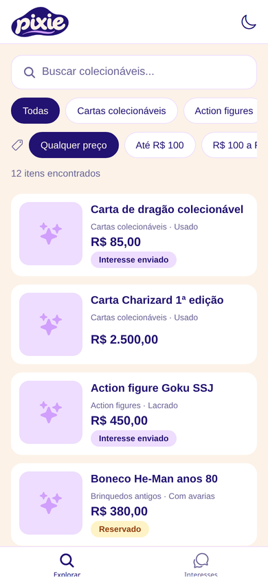
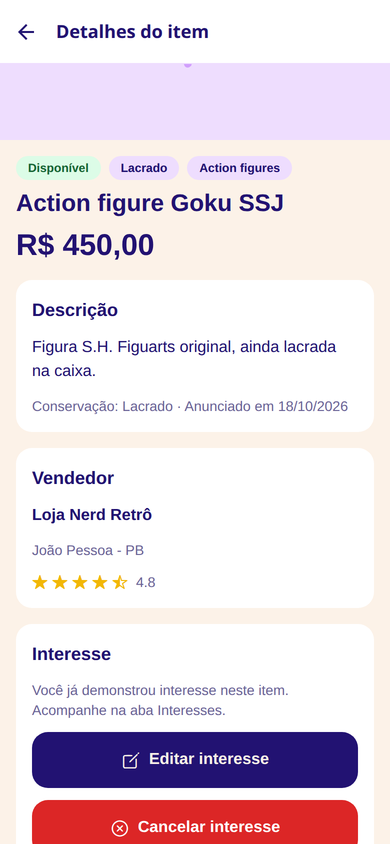
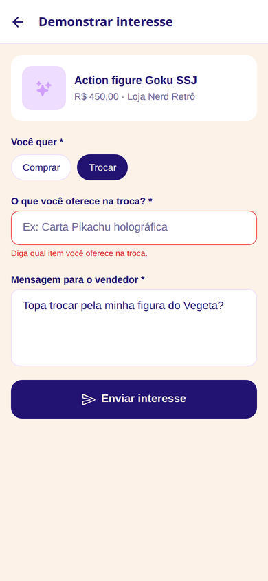
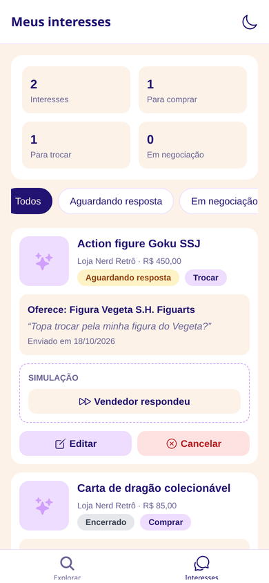
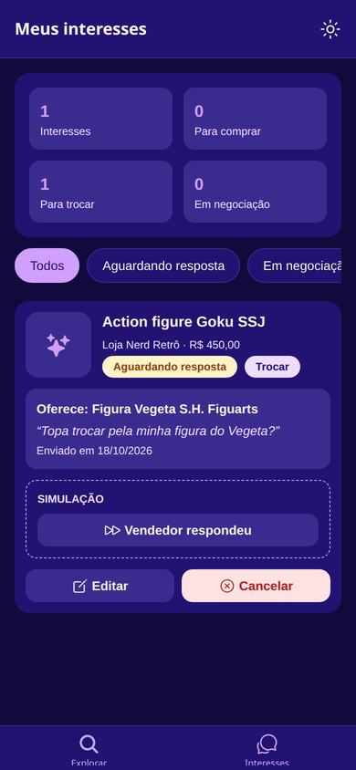

<p align="center">
  
</p>

# Pixie — colecionáveis para o comprador

Aplicativo mobile do **Projeto 1** da disciplina Programação para Dispositivos Móveis (IFPB Campus Esperança, 2026.2).

O Pixie é um marketplace de **itens colecionáveis** (cartas, action figures, moedas, quadrinhos, vinis...). Esta versão é a do **comprador**: ele cria uma conta, explora os itens anunciados pelos vendedores e **demonstra interesse** em comprar ou trocar, enviando uma proposta e uma mensagem ao vendedor.

Os dados ficam na nuvem, no **Supabase**, o mesmo banco usado pelo **Pixie Seller** (projeto web de DAW III), onde os vendedores cadastram os anúncios. Um item anunciado no Pixie Seller aparece aqui para o comprador.

> Demonstrar interesse não é comprar: o item continua sendo um anúncio do vendedor. O interesse registra a proposta do comprador.

## Funcionalidades

| Requisito | Onde está no app |
| --- | --- |
| **RF01 — CRUD completo** | **Interesse** (entidade principal): demonstrar interesse em um item, listar, editar (tipo, valor oferecido ou item da troca e mensagem) e cancelar. |
| **RF02 — Persistência** | Banco **Supabase** (PostgreSQL na nuvem): interesses, itens e categorias ficam salvos na conta do usuário. O login e a preferência de tema ficam salvos no aparelho. |
| **RF03 — Listagem inteligente** | Explorar: busca por título, filtro por categoria e por faixa de preço. Interesses: filtro por status da negociação. |
| **RF04 — Validação** | Interesse: tipo (comprar/trocar) e mensagem obrigatórios; valor oferecido com formato validado; item da troca obrigatório quando o tipo é troca. Cadastro: nome, CPF (com dígitos verificadores), e-mail, senha com no mínimo 6 caracteres e confirmação de senha. Os erros aparecem embaixo de cada campo e somem quando o campo é corrigido. |
| **RF05 — Navegação** | Expo Router: telas de login e cadastro, abas Explorar e Interesses, tela de detalhe do item e formulário de interesse. Sem login, o app abre na tela de login. |
| **RF06 — Feedback** | Confirmação antes de cancelar e de sair da conta, mensagens de sucesso e erro em português, indicadores de carregamento. |

**Conta:** cadastro de comprador (nome, CPF, e-mail e senha), login e botão de sair no topo das abas.

**Detalhe do item:** foto, preço, categoria, marca/fabricante, conservação, quantidade, data do anúncio, descrição, nome do vendedor e o espaço **Demonstrar interesse**. Os rótulos seguem os do Pixie Seller.

**Explorar:** mostra os anúncios disponíveis e vendidos. Os anúncios **pausados** pelo vendedor não aparecem para o comprador.

**Extras (pontuação bônus):**
- Tema claro / escuro (botão no topo, salvo no aparelho)
- Estatísticas: total de interesses, quantos para comprar, para trocar e em negociação

## Tecnologias

- [React Native](https://reactnative.dev) + [Expo SDK 57](https://docs.expo.dev)
- [Expo Router](https://docs.expo.dev/router/introduction/) — navegação por arquivos
- [Supabase](https://supabase.com) (`@supabase/supabase-js`) — banco de dados e login
- [expo-sqlite](https://docs.expo.dev/versions/latest/sdk/sqlite/) — guarda a sessão de login e o tema no aparelho (`localStorage`)
- [NativeWind](https://www.nativewind.dev) (Tailwind CSS) — estilos
- expo-image
- TypeScript

## Como executar

Pré-requisitos: [Node.js](https://nodejs.org) 20+ e o app **Expo Go** no celular Android (ou um emulador Android).

### 1. Instalar

```bash
git clone <url-do-repositorio>
cd pixie-app
npm install
```

### 2. Configurar o Supabase

Crie o arquivo `.env.local` na raiz do projeto com a URL e a chave pública do projeto Supabase (as mesmas do Pixie Seller):

```
EXPO_PUBLIC_SUPABASE_URL=https://ucakjcquyawyzxrumiot.supabase.co
EXPO_PUBLIC_SUPABASE_ANON_KEY=sb_publishable_JoQEAGIEFgcRW5eBPPJCng_4B0ayQhx
```

### 3. Rodar

```bash
npx expo start
```

Depois, escaneie o QR Code com o Expo Go ou pressione `a` para abrir no emulador Android.

> Se o celular não conectar ao computador (redes diferentes), use `npx expo start --tunnel`.
> O app também abre no navegador (tecla `w`), mas o alvo do projeto é Android.

Outros comandos:

```bash
npx expo lint      # verifica o código
npx tsc --noEmit   # verifica os tipos
```

## Banco de dados

O banco é compartilhado com o Pixie Seller. As tabelas `categorias`, `produtos` e `vendedor` são do Pixie Seller; o script deste projeto cria só o que o comprador precisa:

| Tabela | Conteúdo |
| --- | --- |
| `categorias` | Categorias dos anúncios (Pixie Seller) |
| `produtos` | Anúncios dos vendedores (Pixie Seller) |
| `vendedor` | Perfil do vendedor (Pixie Seller) |
| `comprador` | Perfil do comprador, criado automaticamente no cadastro |
| `interesses` | Propostas de compra ou troca do comprador em um produto |
| `vendedor_publico` | View com só o `id` e o `nome` do vendedor, para mostrar no anúncio sem expor CPF e e-mail |

As regras de acesso (RLS) garantem que cada comprador só vê, edita e cancela os próprios interesses.

A estrutura do banco SQLite usado na primeira versão do app continua em `src/banco/banco.ts`, mas não é mais usada.

## Estrutura do projeto

```
src/
├── app/              # Telas (cada arquivo é uma rota do Expo Router)
│   ├── (autenticacao)/ # Login e cadastro
│   ├── (abas)/       # Explorar e Meus interesses
│   ├── produto/      # [id] = detalhes do item
│   └── interesse/    # formulario = demonstrar/editar interesse
├── servicos/         # Acesso ao Supabase: login, produtos, categorias, interesses
├── banco/            # Estrutura do SQLite da primeira versão (sem uso)
├── componentes/      # Componentes visuais reutilizáveis
├── modelos/          # Tipos das classes do modelo de negócio
├── tema/             # Cores da marca e tema claro/escuro
└── utils/            # Formatação, validação e alertas
supabase/             # Script SQL das tabelas do comprador
```

As telas nunca acessam o banco diretamente: elas chamam funções da pasta `servicos/` (ex.: `criarInteresse(produtoId, dados)`), e as regras de validação ficam em `utils/validacao.ts`.

## Capturas de tela

| Explorar | Detalhe | Formulário (validação) | Interesses | Tema escuro |
| --- | --- | --- | --- | --- |
|  |  |  |  |  |

## Referências

As configurações abaixo seguem a documentação oficial das bibliotecas:

- Supabase com Expo (cliente, sessão no `localStorage` e renovação do login): https://docs.expo.dev/guides/using-supabase/
- NativeWind com Expo (`babel.config.js`, `metro.config.js`, `tailwind.config.js`): https://www.nativewind.dev/docs/getting-started/installation
- expo-sqlite, incluindo a configuração para web (`metro.config.js`): https://docs.expo.dev/versions/v57.0.0/sdk/sqlite/
- Expo Router (abas, pilha de telas e rotas protegidas): https://docs.expo.dev/router/introduction/
