# Pixie — Documentação do Projeto 1

**Disciplina:** Programação para Dispositivos Móveis — IFPB Campus Esperança, 2026.2
**Tecnologia:** React Native com Expo (SDK 58) e Supabase

## 1. Tema

O **Pixie** é um marketplace de **artigos colecionáveis** (cartas, action figures, moedas, quadrinhos, discos de vinil). O modelo de negócio parte de um problema real: faltam plataformas especializadas para quem coleciona.

Este app é a versão do **comprador**. Ele cria uma conta, explora os itens anunciados pelos vendedores, consulta os detalhes e **demonstra interesse** em comprar ou trocar: envia uma proposta (valor oferecido ou item para troca) e uma mensagem ao vendedor, e acompanha o status da negociação. Quando o vendedor aceita a proposta, os dois conversam por um **chat em tempo real**.

Os vendedores usam o **Pixie Seller**, o projeto web da disciplina DAW III. Os dois sistemas compartilham o mesmo banco no Supabase. Um anúncio cadastrado no Pixie Seller aparece no app, e o interesse enviado pelo app chega ao vendedor no Pixie Seller.

A **entidade principal** é o **Interesse**, com CRUD completo. Demonstrar interesse não significa comprar: o item continua sendo um anúncio do vendedor.

## 2. Modelo de dados

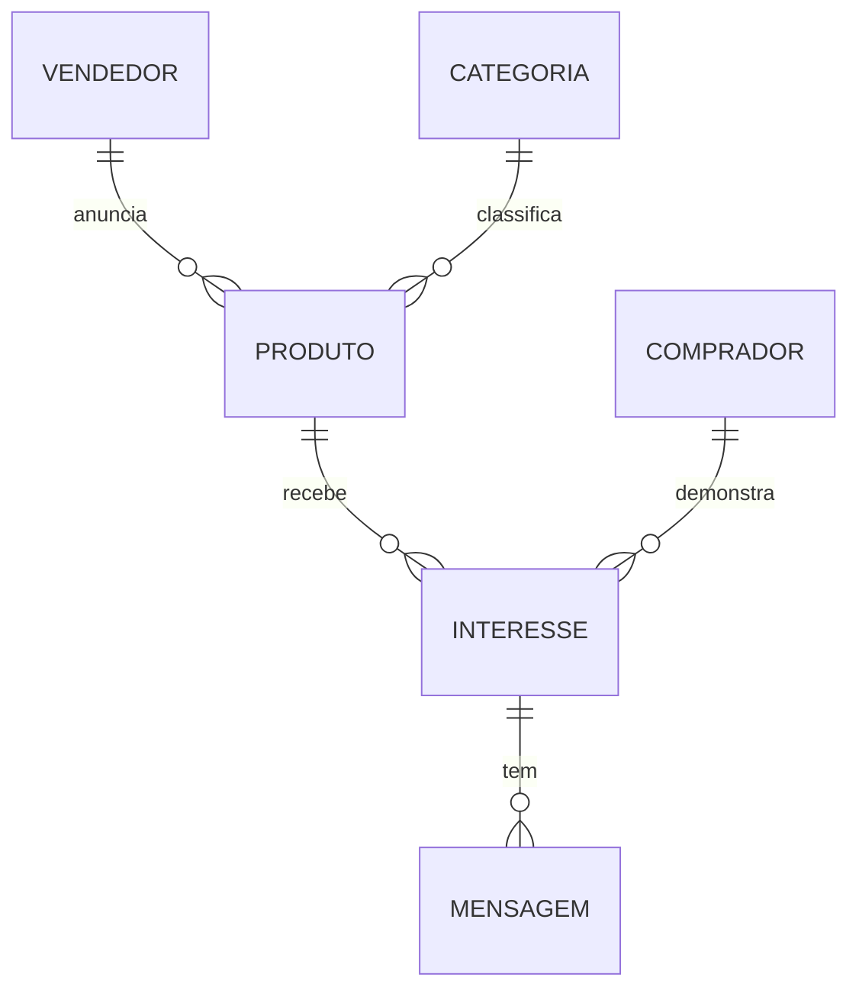

Um produto pode receber interesses de **vários compradores**, mas cada comprador tem **no máximo um interesse por produto**.

| Classe / tabela | Campos | Observações |
| --- | --- | --- |
| **Interesse** (principal) — `interesses` | id, produtoId, compradorId, tipo, valorOferecido, itemTroca, mensagem, status, criadoEm | `tipo`: compra ou troca. `status`: aguardando resposta, em negociação ou encerrado. `UNIQUE (produto_id, comprador_id)`: um interesse por comprador em cada produto. |
| **Produto** — `produtos` | id, titulo, descricao, preco, condicao, status, categoriaId, vendedorId, marca, quantidade, imagens, criadoEm | Cadastrado pelo vendedor no Pixie Seller. `condicao` (conservação): lacrado, novo, usado ou com avarias. `status`: rascunho, disponível, pausado ou vendido. |
| **Comprador** — `comprador` | id, nome, cpf, email, criadoEm | Criado automaticamente quando a pessoa se cadastra pelo app. O `id` é o mesmo do usuário do Supabase Auth. |
| **Vendedor** — `vendedor` | id, nome, cpf | Cadastrado pelo Pixie Seller. O app lê só `id` e `nome` pela view `vendedor_publico`, sem expor os dados pessoais do vendedor. |
| **Categoria** — `categorias` | id, nome | Compartilhadas com o Pixie Seller. |
| **Mensagem** — `mensagens` | id, interesseId, autorId, conteudo, criadoEm | Conversa entre o comprador e o vendedor de um interesse. O `autorId` é preenchido pelo banco com o usuário logado. `conteudo`: 1 a 1000 caracteres. |

**Regras de negócio**

- Cada comprador pode demonstrar um interesse por item. Para mudar a proposta, ele edita o interesse que já existe.
- Tipo e mensagem (10 a 300 caracteres) são obrigatórios.
- Na compra, o valor oferecido é opcional, mas precisa ser maior que zero. Na troca, é obrigatório dizer qual item é oferecido (3 a 100 caracteres).
- Só é possível demonstrar interesse em itens disponíveis e com quantidade em estoque. Anúncios em rascunho ou pausados pelo vendedor não aparecem no app.
- O comprador não altera o status do interesse. Quem aceita a proposta (em negociação) ou encerra é o vendedor, pelo Pixie Seller.
- O chat só existe depois que o vendedor aceita a proposta. Mensagens só podem ser enviadas enquanto o interesse está em negociação; depois de encerrado, a conversa fica só para leitura.
- Cadastro: nome, CPF válido (com dígitos verificadores), e-mail, senha com no mínimo 6 caracteres e confirmação de senha.

**Segurança:** as regras de acesso do banco (Row Level Security) garantem que cada comprador só vê, edita e cancela os próprios interesses, e só lê e envia mensagens nas próprias conversas, mesmo que alguém tente acessar a API diretamente.

## 3. Justificativa da persistência: Supabase (PostgreSQL)

A primeira versão do app usava SQLite (`expo-sqlite`), com dados de exemplo no próprio aparelho. Como o vendedor não recebia a proposta de verdade, a resposta dele era simulada por um botão. Na versão atual, os dados foram migrados para o **Supabase**:

1. **Dados compartilhados entre os dois sistemas:** o comprador (app) e o vendedor (Pixie Seller, web) leem e gravam no mesmo banco. A proposta enviada pelo app chega de verdade ao vendedor, e a resposta dele aparece no app. Com um banco local isso não seria possível.
2. **Modelo relacional:** o interesse aponta para um produto e para um comprador; o produto aponta para uma categoria e um vendedor. O PostgreSQL garante essas ligações com chaves estrangeiras e impede dados inválidos com restrições `CHECK` e `UNIQUE` (por exemplo, tipo desconhecido ou dois interesses do mesmo comprador no mesmo item).
3. **Consultas no banco:** busca por título (`ilike`), filtros por categoria, preço e status, ordenação e junções (`produtos` com `categorias`) rodam no servidor. O app recebe só o resultado.
4. **Login e segurança:** o Supabase Auth cuida do cadastro e do login, e o RLS limita cada usuário aos próprios dados.
5. **Persistência local:** o `expo-sqlite` continua no projeto como `localStorage` do aparelho. Ele guarda a sessão de login (o usuário não precisa entrar de novo a cada vez que abre o app) e a preferência de tema claro/escuro.

## 4. Capturas de tela

| Login | Explorar (busca e filtros) | Detalhe | Interesses | Conversa |
| --- | --- | --- | --- | --- |
| 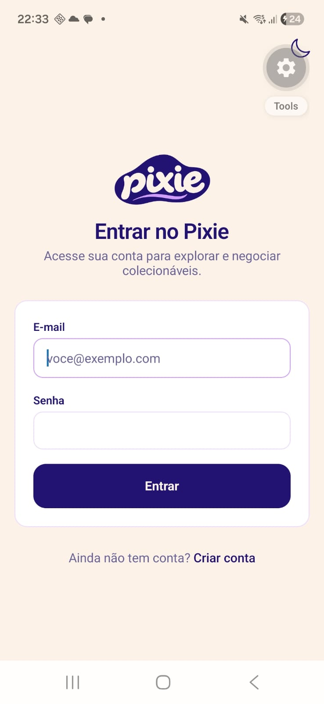 | 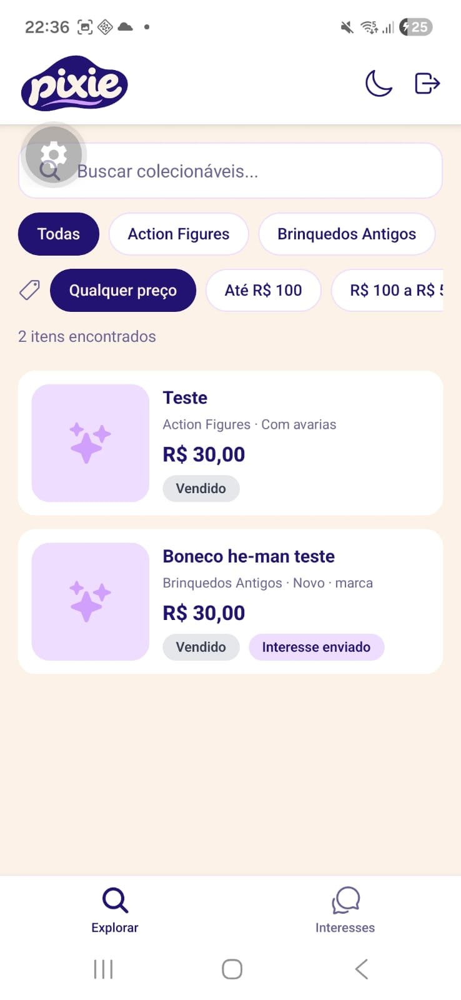 | 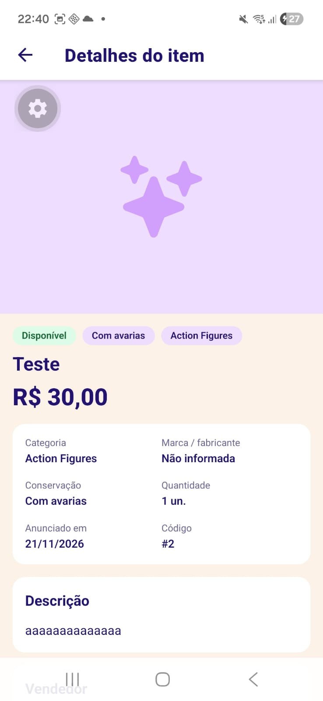 | 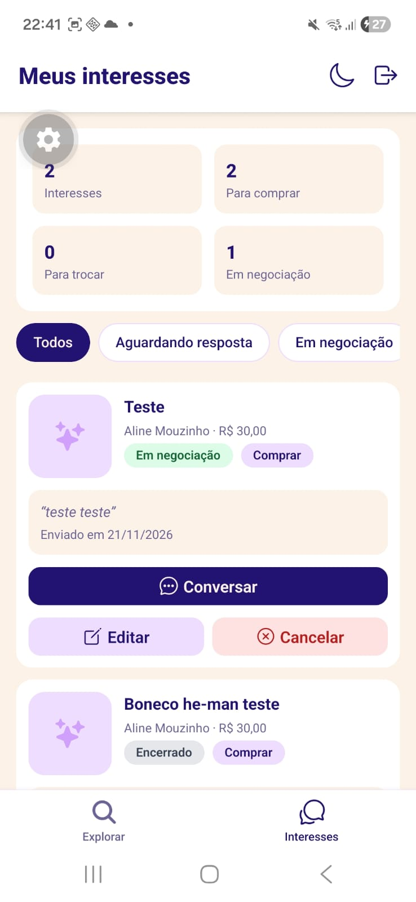 | 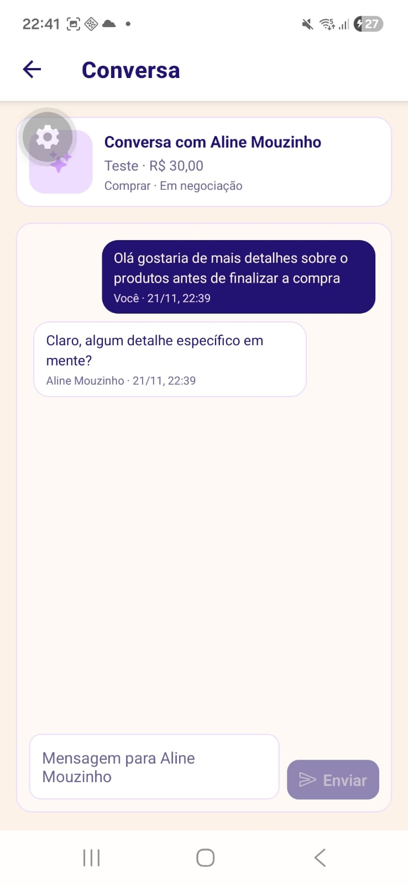 |
| 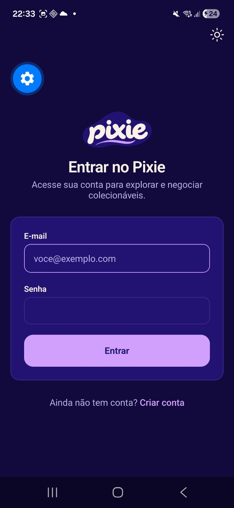 | 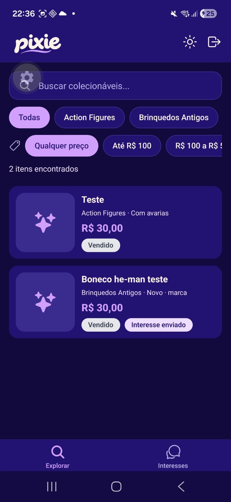 | 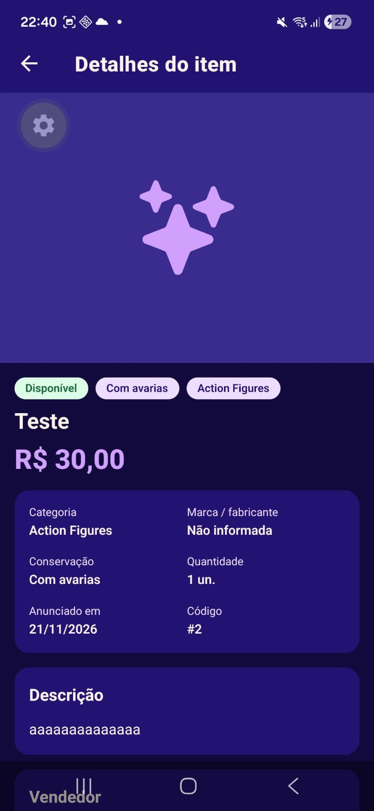 | 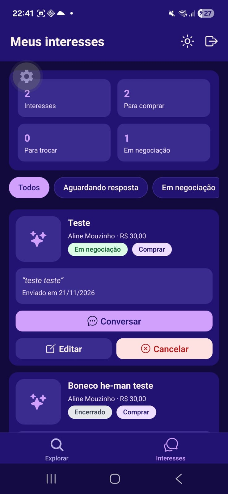 | 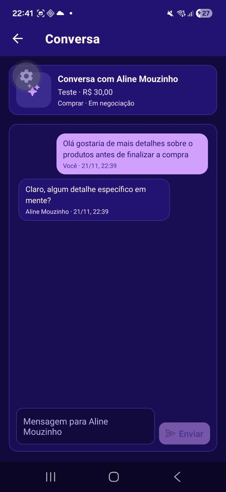 |

Primeira linha: tema claro. Segunda linha: tema escuro.
