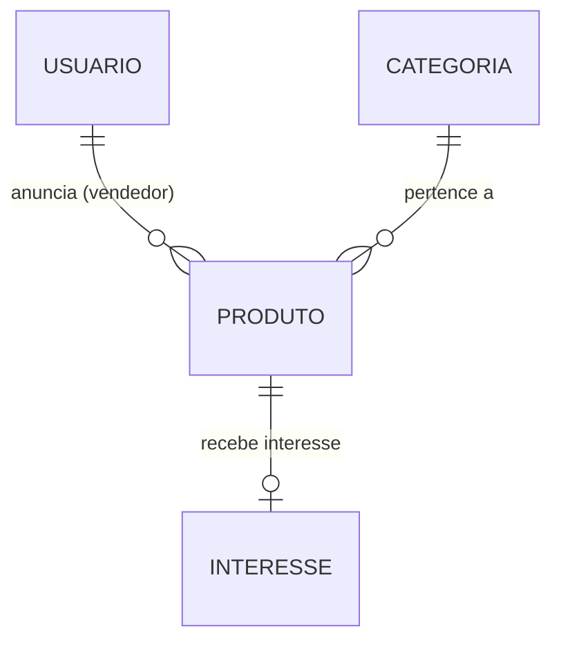
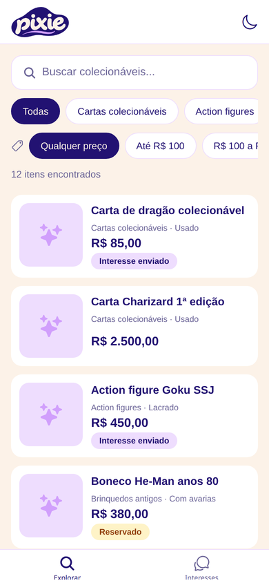
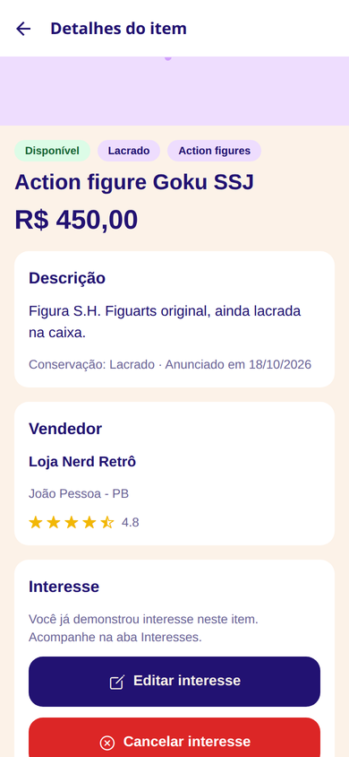
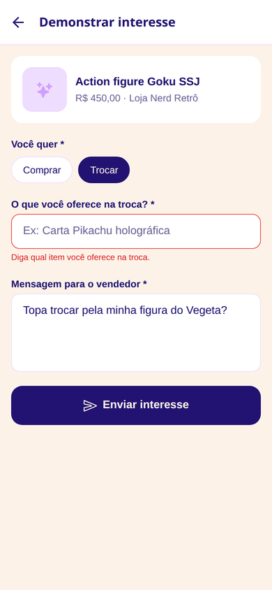
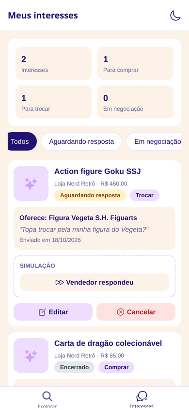
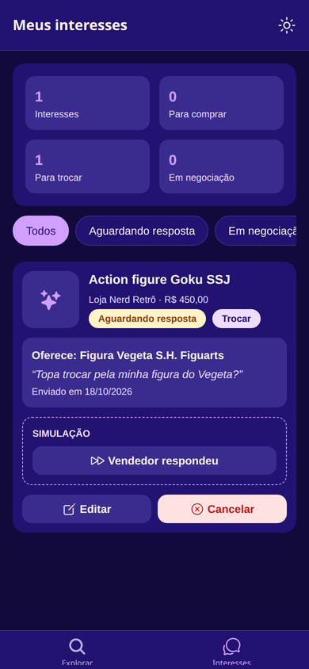

# Pixie — Documentação do Projeto 1

**Disciplina:** Programação para Dispositivos Móveis — IFPB Campus Esperança, 2026.2
**Tecnologia:** React Native com Expo (SDK 57)

## 1. Tema

O **Pixie** é um marketplace de **artigos colecionáveis** (cartas, action figures, moedas, quadrinhos, discos de vinil). O modelo de negócio parte de um problema real: faltam plataformas especializadas para quem coleciona.

Este app é a versão do **comprador**. Ele explora os itens anunciados pelos vendedores, consulta os detalhes e **demonstra interesse** em comprar ou trocar: envia uma proposta (valor oferecido ou item para troca) e uma mensagem ao vendedor, e acompanha o status da negociação.

A **entidade principal** é o **Interesse**, com CRUD completo. Demonstrar interesse não significa comprar: o item continua sendo um anúncio do vendedor.

## 2. Modelo de dados

| Classe / tabela | Campos | Observações |
| --- | --- | --- |
| **Interesse** (principal) — `interesses` | id, produtoId, tipo, valorOferecido, itemTroca, mensagem, status, criadoEm | `tipo`: compra ou troca. `status`: aguardando resposta, em negociação ou encerrado. Um interesse por produto (`UNIQUE`). |
| **Produto** — `produtos` | id, titulo, descricao, preco, condicao, status, categoriaId, vendedorId, criadoEm | `condicao` (conservação): lacrado, novo, usado ou com avarias. `status`: disponível, reservado ou vendido. |
| **Usuario** (vendedor) — `usuarios` | id, nome, cidade, telefone, reputacao | `reputacao` é a nota média de 0 a 5. |
| **Categoria** — `categorias` | id, nome | 8 categorias já cadastradas. |

Também existe a tabela `configuracoes` (chave e valor), que guarda a preferência de tema.

**Regras de negócio**

- Só é possível demonstrar um interesse por item.
- Tipo e mensagem (10 a 300 caracteres) são obrigatórios.
- Na compra, o valor oferecido é opcional, mas precisa ser maior que zero. Na troca, é obrigatório dizer qual item é oferecido.
- Itens vendidos não aceitam novos interesses.

**Simplificações:** os vendedores e os anúncios já vêm cadastrados (dados de exemplo), porque o app é do comprador. Como não há servidor, o vendedor não recebe a proposta de verdade: o app mostra o contato dele, e a resposta do vendedor (mudança de status) é simulada por um botão marcado como "Simulação". O comprador não altera o status pelo formulário.

## 3. Justificativa da persistência: SQLite (`expo-sqlite`)

O modelo do Pixie é **relacional**: o interesse aponta para um produto, que aponta para uma categoria e um vendedor. Por isso o SQLite foi escolhido no lugar do AsyncStorage:

1. **Relacionamentos e integridade:** chaves estrangeiras (`PRAGMA foreign_keys = ON`) e restrições `CHECK`/`UNIQUE` impedem dados inválidos, como tipo desconhecido ou dois interesses no mesmo item.
2. **Consultas eficientes:** busca (`LIKE`), filtros por categoria, preço e status (`WHERE`), ordenação (`ORDER BY`), junções (`JOIN`) e estatísticas (`COUNT`, `SUM`) rodam dentro do banco. Com AsyncStorage seria preciso carregar tudo na memória e filtrar no JavaScript.
3. **Transação na criação do banco:** tabelas e dados de exemplo são criados com `withTransactionAsync`. Se o app for fechado no meio, nada fica pela metade.
4. **Versionamento do esquema:** `PRAGMA user_version` guarda a versão do banco, e cada migração roda uma única vez, sem perder os dados de quem já usava o app.
5. **Compatibilidade:** o `expo-sqlite` está incluído no Expo Go e funciona no Android sem configuração nativa.

## 4. Capturas de tela

| Explorar (busca e filtros) | Detalhe | Formulário (validação) | Interesses | Tema escuro |
| --- | --- | --- | --- | --- |
|  |  |  |  |  |
